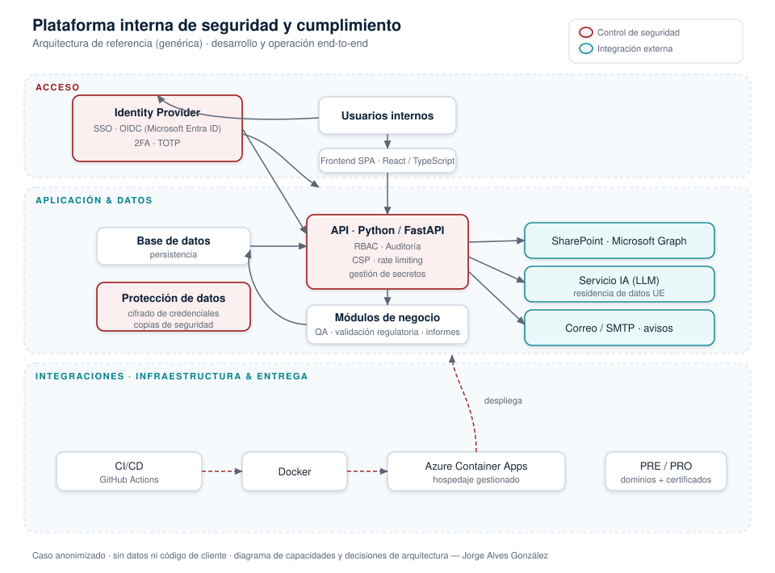

# Plataforma interna de seguridad y cumplimiento — caso de arquitectura

> **Caso de portfolio anonimizado.** Describe el diseño, la arquitectura y las
> decisiones técnicas de una plataforma que diseñé, construí y opero de principio a
> fin. **No contiene código ni datos de ningún cliente**; es documentación de
> capacidades y criterio de ingeniería.

**Rol:** diseño, desarrollo y operación (end-to-end) · **Modalidad:** remoto
**Sector:** entornos regulados (juego online / iGaming)

---

## Contexto y reto

Una empresa que opera en un sector fuertemente regulado necesitaba, **partiendo de
cero**, una plataforma interna para:

- Automatizar su **control de calidad regulatorio** en varias jurisdicciones.
- Centralizar la **seguridad** y el **control de acceso** de su equipo.
- Sustituir procesos manuales (validaciones, informes, avisos) por flujos
  automatizados, auditables y escalables.

## Solución

Diseñé y construí una plataforma web segura desplegada en la nube, con seguridad y
cumplimiento integrados desde el primer día.

- **Frontend** SPA (React / TypeScript) y **API** en Python / FastAPI.
- **Acceso seguro**: SSO con OIDC (Microsoft Entra ID), **RBAC**, **2FA (TOTP)**,
  registro de **auditoría**, cabeceras de seguridad/CSP, rate limiting y gestión de
  secretos.
- **Módulos de negocio**: validación regulatoria multi-jurisdicción, QA y generación
  de informes ejecutivos.
- **Integraciones**: documentación en SharePoint vía Microsoft Graph (acceso
  delegado por usuario), un servicio de IA (LLM) con **residencia de datos en la UE**
  y control de coste, y avisos por correo.
- **Datos**: base de datos con **cifrado de credenciales** y **copias de seguridad**.
- **Infra y entrega**: Docker + **Azure Container Apps**, CI/CD con GitHub Actions y
  entornos de **pre-producción y producción** con dominios y certificados gestionados.

## Documentación

- [`docs/arquitectura.md`](docs/arquitectura.md) — decisiones de diseño (por qué cada pieza).
- [`docs/seguridad.md`](docs/seguridad.md) — controles de seguridad implementados.
- [`docs/normativas.md`](docs/normativas.md) — marcos y normativas con los que he trabajado.

## Resultados

- Procesos manuales críticos **automatizados** (validaciones, informes, avisos).
- Base de **seguridad y operación** lista para escalar (modelo de roles y onboarding
  del área de IT definidos).
- Calidad sostenible: **+180 pruebas automatizadas** y despliegue continuo.

## Stack

`Azure` · `Azure Container Apps` · `Docker` · `GitHub Actions` · `Python` ·
`FastAPI` · `React` · `TypeScript` · `Microsoft Entra ID` · `OIDC` · `RBAC` ·
`Microsoft Graph` · `SharePoint`

---

### Nota de confidencialidad

Este repositorio es una **representación anonimizada** con fines de portfolio. No
incluye código fuente, configuraciones, credenciales ni datos de ningún cliente, y
no permite reproducir la solución original. Los nombres de producto (Azure, Entra
ID…) se citan únicamente para describir el stack tecnológico utilizado.

**Autor:** Jorge Alves González · [LinkedIn](https://www.linkedin.com/in/jorge-alves-gonzález)
